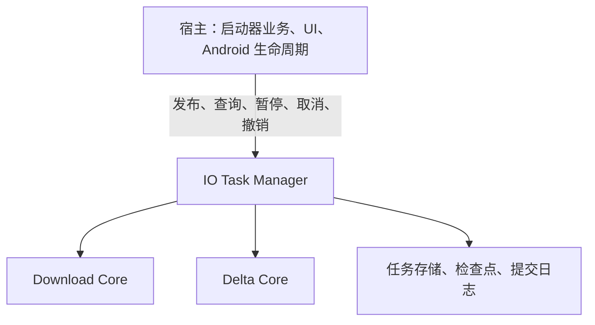

# IO Task Manager

## 当前交付状态

本模块现已包含独立的 Task/Worker/WorkerGroup 核心模型和内存存储测试。
**尚未实现持久化后端、下载、增量操作或生产接入，不可用于生产。**
`:app` 尚未依赖本模块，现有业务入口和各业务的私有队列、恢复逻辑没有改变。
下文规定目标职责与安全约束，不表示这些能力已经实现或验证。

## 确认的架构

宿主只通过 IO Task Manager 发布和控制受管理的 IO 任务；Manager 是任务存储和执行的
唯一所有者，调用 Download Core 和 Delta Core 完成实际操作。



实际 Gradle 依赖方向：

```text
未来：app → io-task-manager
当前：io-task-manager → download-core
                     → delta-core
```

两个 Core 使用 `implementation` 依赖，不作为宿主需要直接使用的 API 导出。
Core 未来承载具体的 Download Task / Delta Task 类型，遵循相同的 Task 执行契约。
目前 Task 基类位于 Manager 模块，Core 尚无实现，因此没有反向编译依赖。
实际实现 Core Task 前需将 Task/Context/结果等共享契约抽到独立 API 模块，或采用
Manager 内部 Task 适配器；不能直接让 Core 反向依赖 Manager 而形成 Gradle 循环。
该拆分本轮不实施，宿主通过 Manager 发布任务的调用方向始终不变。

### 所有权

- **宿主**：描述业务意图，发布任务、观察结果；提供 Android 生命周期、通知、URI
  权限和凭证等平台适配。不自行编排 Core、执行任务或维护另一套恢复队列。
- **IO Task Manager**：接纳并持久化任务，实例化执行单元，调度、执行和组合步骤，
  管理检查点、资源预算、冲突锁、提交、恢复与清理。
- **Download Core**：提供下载能力和可实例化的执行单元，不保存任务状态或自行调度。
- **Delta Core**：提供可逆内容存储、历史核验、增量转换和安全内容操作能力；任务状态
  和执行权仍属于 Manager，不拥有独立恢复器。
- **存储及平台适配器**：在 Manager 控制下执行读写、锁和平台操作，不私自启动任务。

唯一任务所有者不意味着所有业务数据、日志、设置和每次底层读写都必须塞进 Manager。
内容和版本记录可以由存储能力管理，但变更必须由受管理任务驱动；任务定义、执行状态、
检查点和提交日志只能由 Manager 组织持久化。

## 业务边界

- 最终所有启动器下载都经过 Manager 调用 Download Core，包括资源、组件、模组、
  补丁、Steam 内容等；不同来源保留各自协议能力，不强行统一为 HTTP Range。
- 模组导入只复制文件并添加模组列表，不强制适配、修补或配置。
- 模组修补是独立可选任务：核对当前内容与历史包，先保存并验证历史，再使用修补包，
  校验完整候选后安全提交，保留回退路径。
- 增量结果仍是完整物理产物，不引入游戏运行期文件覆盖或虚拟 JAR。
- 下载、生成、提交和业务登记是不同阶段，不能以下载完成冒充整体成功。
- 登录、元数据查询、日志、设置和系统安装是否属于持久任务，应另按业务语义划界；
  不将每次网络请求或 `read()` 都建为持久任务。远端写入也不能假定可无条件撤销。

## 任务模型与执行契约

当前核心 API 已表达以下概念；持久化格式和 Android 后端仍未确定。

1. **任务定义**：可持久化的任务类型及格式版本、输入身份、参数、目标和约束。
   不序列化线程、连接、任意闭包或 Android Context。输入在恢复时必须仍可取得，
   URI 权限失效或源文件改变需明确报告，不能悄悄换用另一个输入。
2. **执行实例**：Manager 根据定义和检查点创建的本次执行对象，持有局部连接、
   缓冲区等资源；执行结束释放资源，不形成 Core 私有后台服务。
3. **执行意图与实际状态**：暂停、取消等请求先保存，再驱动执行器收敛；请求已接收
   不等于已经停止。精确的状态机和状态转换表待实现前确认。
4. **检查点**：仅记录经过验证的工作及其输入身份，例如完整 chunk、部分文件的
   远端标识、已验证候选、提交阶段。进度百分比、日志和临时文件存在不是恢复证据。
5. **结果与撤销信息**：明确已发布产物、校验结果、业务提交结果、失败原因，以及
   是否可撤销、所依赖的历史内容。不能将清理共享缓存等同于撤销业务结果。

联动由 Manager 编排，例如：

```text
宿主发布修补任务
→ 核对基础内容与历史
→ 必要时调用 Download Core 获取修补包
→ 调用 Delta Core 保存历史并生成完整候选
→ 校验、提交内容与业务登记
→ 记录结果和可撤销信息
```

Core 只能报告进度、检查点或操作结果，不直接发布和执行另一 Core 的任务。
内部并行工作属于 Manager 管理的执行作用域和预算，不能脱离取消和恢复控制。

## 当前核心模型

- `Task`：声明稳定 ID 和类型，实现 `execute(TaskContext)`；通过上下文检查取消、
  读取已有检查点和保存新检查点，并返回 `Completed`、`Waiting`、`Cancelled` 或
  `Failed`。异常会转换为稳定错误结果。
- `Worker`：在独立子 Job 中执行一个 Task，进入并发额度后写入 `RUNNING`，统一处理
  协作式取消和业务异常。取消一个 Worker 不会取消调用者或其他 Worker。
- `WorkerGroup`：先写入 `QUEUED`，再创建 Worker 并限制并行数；提供提交、继续、
  重试、取消、查询和等待当前尝试结果的入口，同 ID 不允许并发执行。
- `TaskStore`：当前提供 `InMemoryTaskStore`，用于独立验证；真正的文件或数据库存储
  后端尚未实现。

`WAITING` 是非终态：释放 Worker 并发额度，宿主补充条件后显式调用 `resume`。
`FAILED` 使用 `retry`，先执行恢复核对；终态不允许通过 `submit` 或 `resume` 隐式重跑。
`recover` 只处理 `QUEUED`/`RUNNING`，不自动唤醒等待任务。Task 的 `recover` 默认返回
等待，具体任务必须核对副作用，明确返回 `Continue`、`Completed`、`Waiting` 或 `Failed`。
批量恢复当前逐个核对，不是批量并行调度。恢复使用调用方重建的 Task 和已保存检查点，
还没有定义序列化、类型注册表或自动重建工厂。

`await` 等待当前尝试完成或进入等待；继续或重试会建立新的等待结果，不代表无限等待
未来终态。终态写入成功后才触发 `TaskCompletionListener`，等待状态不触发该回调；
回调异常交给 `onCallbackError`，不能改写任务结果。回调仅是进程内通知，不承诺崩溃后
恰好一次。主动取消等待/排队/运行任务均被支持；运行任务需协作式停止并完成 unwind。
调用者取消会停止 Worker，记录取消后继续传播给调用者，不把调用者取消吞成正常返回。

存储写入同步返回后才继续执行；存储异常向调用方传播，不伪装为业务失败，不保证后端
自身的原子性。`TaskContext` 仅供单任务协程使用，内部并行代码不能并发修改检查点。
当前 `WorkerGroup` 是协程调用范围内的
执行器，尚未提供跨进程租约、持久调度唤醒或任意任务 DAG。

## 安全、中断与恢复要求

- **先持久化再产生副作用**：任务接纳成功必须意味着定义已经可靠保存。
- **统一预算与冲突协调**：控制任务、连接、分块、CPU、内存和临时空间，防止多层
  并发相乘。执行所有权和目标冲突要跨进程有效，心跳超时不等于已夺走旧执行者写权。
- **暂停**：在安全检查点停止，保存可验证进度；算法不能续算时需明确从该步骤重做。
- **取消**：停止后续工作并按策略释放临时资源和引用；不能在线程尚未停止时删除输出。
- **撤销**：处理已提交结果，和取消分开；共享对象仍有引用时不可误删。消耗的流量、
  最终物理删除和无法确认的远端写入不能承诺无条件撤销。
- **准备与激活分离**：下载和转换不直接破坏当前内容；候选验证通过后才提交，
  历史内容在回退承诺有效期间不能被回收。
- **明确提交边界**：允许短暂不可中断提交窗口，不能在任意文件写入点强制中止。
  多文件和业务登记的提交窗口必须有可恢复协议，而不是仅依赖异常处理。
- **恢复先核对后重试**：依据检查点、产物和提交日志判断继续、补记完成、回滚或等待
  处理；不能假设步骤只执行一次。未知远端结果不可盲目重放。
- **内容身份与信任分开**：摘要、协议校验和发布者认证不是同一件事；恢复与撤销前
  核对输入及当前目标，避免覆盖外部或后续任务的新修改。
- **凭证不入普通记录**：任务只存凭证引用，不能在检查点、错误和日志中保存秘密。

`.part`、chunk 缓存、活动心跳和 marker 都不是完整任务日志。Android Service 仅是运行
宿主，不保证进程永不退出；重新进入宿主后应通过 Manager 统一恢复入口核对状态。

## 后续需要确认的实现选择

- 持久化后端、日志落盘和提交协议、任务格式升级及未知类型处理。
- 精确状态机、步骤组合形式、去重策略、重试和恢复策略。
- 撤销是否作为关联的新任务，以及历史保留期和清理授权。
- 文件锁与执行租约的实现，多进程部署方式、资源额度和输入接纳方式。
- 平台适配接口及具体下载协议；Android 文件系统原子性和持久性验证。

现有 Workshop 队列、Steam Cloud journal 和资源 generation/pointer 是设计证据，
不是必须一比一移植的接口；本模块尚未引用这些实现或现有增量原型。

## 验证入口与范围

从仓库根目录离线验证模块配置及构建：

```bash
./gradlew --offline :io-task-manager:build :download-core:build :delta-core:build
```

当前测试覆盖成功、异常和显式失败、等待后继续、排队/运行/调用者取消、回调异常隔离、
重复提交、重试核对、并行上限、存储异常和中断任务恢复。执行命令：

```bash
./gradlew --offline :io-task-manager:test :io-task-manager:build
```

这些是核心模型测试，不证明文件提交或进程崩溃后的真实持久化安全性。后续应使用确定性的本地复制、增量生成/提交/还原、受控 HTTP 场景，覆盖各检查点和
提交窗口退出、损坏输入、磁盘不足、并发冲突、取消及重复恢复；无需设备安装。
采用 JDK 21 工具链与现有 JVM 实验模块一致，不代表已验证 Android API 或字节码兼容。

Android 真机进程退出/崩溃恢复测试位于 app 的 androidTest 中，具体范围、执行前提与
验证限制见 [DEVICE_TESTS.md](DEVICE_TESTS.md)。测试使用独立测试进程和 AtomicFile
夹具，不代表已实现生产持久化后端；真机结果须以实际授权执行记录为准。
# 新持久化模型

Task / TaskPlan 的确认设计与实现见 [DURABLE_TASKS.md](DURABLE_TASKS.md)。新模型使用
`io.stamethyst.iotask.durable`，取消周期性 Continue，采用安全点控制请求、业务元数据
checkpoint、文件持久化和工厂重建。下文保留早期模型说明，非新模型 API 规范。
